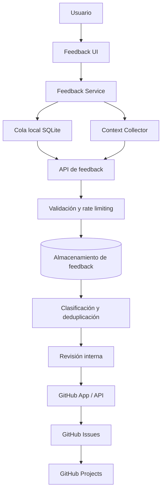

# Clio Feedback Core

## Plan de producto e implementación

**Estado:** Roadmap aprobado — **Fase 1 (local, desktop) implementada**
**Producto:** Clio Reader
**Alcance:** Desktop (Electron + React) y Mobile (React Native)
**Destino de gestión:** GitHub Issues + GitHub Projects
**Principio rector:** feedback de fricción casi cero

### Estado por fase

| Fase | Descripción                  | Estado                                                                                                                                |
| ---- | ---------------------------- | ------------------------------------------------------------------------------------------------------------------------------------- |
| 0    | Definición y decisiones      | ✅ Parcial: reacciones, categorías, metadatos y áreas aprobados; pendientes: retención, almacenamiento backend, límites de frecuencia |
| 1    | Feedback Core local          | ✅ **Desktop**: UI, contrato, servicio, cola local SQLite. ⬜ Mobile                                                                  |
| 2    | API y recepción centralizada | ⬜ Pendiente                                                                                                                          |
| 3    | Consola interna y GitHub     | ⬜ Pendiente                                                                                                                          |
| 4    | Inteligencia de producto     | ⬜ Pendiente                                                                                                                          |

### Implementación de Fase 1 (desktop)

- **Contrato y entidad**: `packages/domain/src/index.ts` (tipos `Feedback*`,
  `createFeedback` con validación, `FEEDBACK_MESSAGE_MAX_LENGTH = 2000`).
- **Servicio**: `packages/feedback` (`FeedbackService`, `collectFeedbackContext`,
  interfaz `FeedbackRepository`).
- **Persistencia**: tabla `feedback` en SQLite (Drizzle). El SQL idempotente vive en
  `packages/storage/drizzle/0000_initial*.sql` y se re-ejecuta en cada arranque.
  Métodos: `saveFeedback`, `listFeedback`, `countFeedbackByStatus`,
  `updateFeedbackStatus`, `removeFeedback`.
- **Bridge desktop**: IPC `repo:*-feedback` + `get-app-info` (versión, plataforma, OS),
  preload (`preload.cjs`/`preload.ts`), `env.d.ts` y `src/bridges/feedback-bridge.ts`.
- **UI**: `src/components/FeedbackPanel.tsx` (reacciones, categoría opcional, comentario
  opcional, aviso de privacidad, confirmación con contador de pendientes).
  Entradas: botón "Compartir feedback" en el Rail (`LibraryView`) y
  "Reportar problema" en `LoadErrorState` (`ReaderView`).
- **Identificador de instalación**: UUID aleatorio en `localStorage`
  (`src/feedback/installation-id.ts`), no derivado de datos personales.
- **Fase 1 no envía nada a red**: los envíos quedan en SQLite con estado `received`
  a la espera de la Fase 2.

### Pendientes decididos (no bloquean Fase 1)

1. Proveedor de almacenamiento central.
2. Persistencia del identificador de instalación (hoy `localStorage`).
3. Periodo de retención/eliminación del feedback.
4. Diagnóstico avanzado (logs/capturas) en la primera versión con backend.
5. Quién revisa y aprueba la creación de Issues.
6. Comunicación de resolución al usuario.

---

## 1. Resumen ejecutivo

Clio Feedback Core será un módulo propio de Clio Reader para recoger
opiniones, problemas, ideas y señales de satisfacción directamente desde
la aplicación.

La experiencia del usuario no debe parecer un formulario de soporte ni
exponer GitHub. El usuario comparte una reacción o comentario en el
contexto de su actividad; Clio captura únicamente los metadatos técnicos
permitidos y el equipo gestiona el feedback desde un backend y GitHub.

**GitHub es una herramienta interna de gestión, no la interfaz de
feedback del usuario final.**

### Objetivos

- Permitir enviar feedback sin crear una cuenta ni iniciar sesión.
- Reducir el envío básico a una interacción de un clic.
- Admitir comentarios opcionales y reportes detallados voluntarios.
- Capturar contexto técnico útil sin pedir al usuario que lo escriba.
- Funcionar con conectividad intermitente mediante una cola local.
- Centralizar el feedback de Desktop y Mobile.
- Convertir feedback seleccionado en Issues sin crear ruido ni
  duplicados.
- Proteger documentos, contenido de lectura, rutas locales y datos
  personales.

### Fuera del alcance inicial

- Sistema completo de atención al cliente.
- Chat en tiempo real con soporte.
- Portal público de votación o roadmap.
- Envío automático de documentos, texto seleccionado o capturas.
- Creación automática de un Issue por cada comentario.
- Identificación obligatoria del usuario.

---

## 2. Principios de experiencia

1.  **Sin registro:** no exigir cuenta, correo ni GitHub.
2.  **Un clic para microfeedback:** una reacción se puede enviar sin
    escribir.
3.  **Comentario opcional:** el texto amplía el contexto, nunca es
    obligatorio.
4.  **Contextual:** la aplicación añade plataforma, versión y área
    cuando sea seguro.
5.  **Progresivo:** pedir más información solo si el usuario decide
    reportar un problema con detalle.
6.  **No intrusivo:** el feedback no debe interrumpir la lectura ni
    bloquear la interfaz.
7.  **Transparente:** explicar qué datos se envían y permitir revisar
    los datos adicionales.
8.  **Resiliente:** si no hay conexión, guardar el envío pendiente y
    reintentar.
9.  **Privacidad por defecto:** no enviar contenido de libros,
    documentos ni rutas locales.
10. **Cierre del ciclo:** cuando una solicitud se resuelva, se podrá
    informar a quienes optaron por recibir novedades.

---

## 3. Experiencia del usuario

### 3.1 Tres niveles de interacción

---

Nivel Experiencia Datos Esfuerzo

---

Microfeedback Elegir una Reacción + Un clic
reacción contexto técnico  
mínimo

Feedback rápido Reacción y Reacción + Bajo
comentario texto + contexto  
opcional

Reporte avanzado Describir pasos y Texto + Voluntario
adjuntar contexto +  
diagnóstico adjuntos  
voluntario autorizados
-----------------------------------------------------------------------

No se debe exigir un reporte avanzado para enviar una reacción o
comentario.

### 3.2 Entrada al feedback

Puntos de acceso recomendados:

- Menú principal: **Compartir feedback**.
- Menú contextual del lector, si el feedback está relacionado con una
  acción concreta.
- Pantalla de error: acceso a **Reportar problema**, sin bloquear la
  recuperación.
- Ajustes: sección de feedback y privacidad.

Evitar mostrar encuestas recurrentes o ventanas emergentes durante la
lectura en la primera versión.

### 3.3 Flujo de microfeedback

1.  El usuario abre el panel de feedback.
2.  Selecciona una reacción.
3.  Opcionalmente escribe un comentario.
4.  Envía.
5.  Clio confirma la recepción.

El panel debe poder cerrarse sin perder la lectura actual. Si el usuario
escribe un comentario y cierra accidentalmente, se puede conservar un
borrador local temporal, con una política clara de caducidad.

### 3.4 Reacciones

Propuesta inicial:

- 😞 Muy mala
- 🙁 Mala
- 😐 Neutral
- 🙂 Buena
- 😍 Excelente

La escala mide la experiencia general o una interacción concreta. No
debe confundirse automáticamente con una clasificación de severidad
técnica.

### 3.5 Tipos de feedback

El usuario puede elegir una categoría si quiere, pero no debe ser un
requisito para el envío:

- Problema
- Idea o mejora
- Algo que me gusta
- Comentario general

El backend puede sugerir una clasificación, pero la clasificación
automática no debe cambiar el sentido del comentario ni crear Issues sin
revisión.

### 3.6 Confirmación

Mensaje recomendado:

> ¡Gracias por ayudarnos a mejorar Clio!

No prometer una respuesta individual ni una fecha de solución. Si el
envío queda pendiente por falta de conexión, informar que se enviará
cuando vuelva la conexión.

---

## 4. Contexto técnico y privacidad

### 4.1 Metadatos permitidos por defecto

- Identificador aleatorio de instalación, no derivado de datos
  personales.
- Versión de Clio.
- Plataforma: Windows, Linux, macOS, Android o iOS.
- Versión del sistema operativo, con granularidad razonable.
- Área de la aplicación: Reader, Library, Annotations, Settings, Sync,
  etc.
- Formato abierto: EPUB, PDF, Markdown o CBZ, si es relevante.
- Tipo de evento o acción reciente, usando nombres de eventos
  permitidos.
- Fecha y hora del envío.
- Idioma de interfaz, si aporta valor.

### 4.2 Datos que no deben enviarse automáticamente

- Contenido del documento o libro.
- Texto seleccionado o resaltado.
- Nombre del archivo o título del documento.
- Ruta local, nombre de usuario del sistema o directorios.
- Credenciales, tokens, cookies o claves.
- Contenido de la base de datos local.
- Capturas de pantalla.
- Logs completos sin filtrado.

### 4.3 Diagnóstico voluntario

Para un reporte avanzado, el usuario podrá seleccionar explícitamente
adjuntar:

- Logs filtrados.
- Captura de pantalla revisable antes de enviar.
- Información técnica adicional.

Antes de enviar, mostrar qué se adjuntará. Aplicar redacción de secretos
y rutas locales. Nunca incluir contenido de documentos por defecto.

### 4.4 Consentimiento y retención

- Informar de manera breve qué datos técnicos acompañan el feedback.
- Separar el consentimiento para diagnóstico adicional del envío
  básico.
- Si se habilitan notificaciones de seguimiento, pedir consentimiento
  independiente.
- Definir una política de retención y eliminación de feedback.
- No usar un identificador de instalación para rastrear actividad
  entre productos o sitios.

---

## 5. Arquitectura propuesta

### 5.1 Vista general



### 5.2 Componentes

Componente Responsabilidad

---

Feedback UI Panel, reacciones, comentario y confirmación
Feedback Service Contrato común para enviar feedback
Context Collector Recopilar metadatos permitidos
SQLite local Cola de envíos pendientes y estado de sincronización
API de feedback Recepción, validación y protección contra abuso
Base de datos backend Registro canónico del feedback
Procesador Clasificación, agrupación y deduplicación
GitHub App Crear y actualizar Issues de forma segura
GitHub Projects Seguimiento del trabajo seleccionado

### 5.3 Decisión de backend

Usar un backend intermedio. No conectar Electron ni React Native
directamente con GitHub.

Una opción coherente con el ecosistema del proyecto es un Cloudflare
Worker como API de recepción, con almacenamiento persistente mediante
una base de datos o servicio compatible.

La elección final del almacenamiento debe considerar:

- Volumen esperado.
- Consultas y agrupación por tipo, versión y módulo.
- Retención y eliminación.
- Coste operativo.
- Facilidad de exportación y respaldo.

**No guardar el token de GitHub en el cliente ni distribuirlo dentro del
instalador.**

### 5.4 Contrato compartido entre plataformas

Definir un contrato independiente de la interfaz para que Electron y
React Native compartan la misma semántica.

```ts
type FeedbackReaction = 'very_negative' | 'negative' | 'neutral' | 'positive' | 'very_positive';

type FeedbackCategory = 'bug' | 'idea' | 'praise' | 'general';

type FeedbackPlatform = 'windows' | 'linux' | 'macos' | 'android' | 'ios';

interface FeedbackContext {
  appVersion: string;
  platform: FeedbackPlatform;
  osVersion?: string;
  area?: string;
  documentFormat?: 'epub' | 'pdf' | 'markdown' | 'cbz';
  eventName?: string;
  locale?: string;
}

interface FeedbackSubmission {
  id: string;
  reaction?: FeedbackReaction;
  category?: FeedbackCategory;
  message?: string;
  context: FeedbackContext;
  createdAt: string;
  diagnosticsConsent: boolean;
  followUpConsent: boolean;
}
```

El contrato debe validarse en cliente y servidor. Los campos opcionales
no deben transformarse en una excusa para recopilar información
adicional.

---

## 6. Modelo de datos inicial

Modelo lógico orientativo; adaptar a la tecnología de persistencia
elegida.

### Tabla `feedback`

---

Campo Tipo Descripción

---

id UUID Identificador del envío

installation_id UUID nullable Identificador aleatorio
de instalación

reaction enum nullable Reacción

category enum nullable Categoría elegida o
revisada

message text nullable Comentario

app_version string Versión de Clio

platform enum Plataforma

os_version string nullable Versión del sistema

area string nullable Área del producto

document_format enum nullable Formato, sin
identificar el
documento

event_name string nullable Evento permitido

diagnostics_consent boolean Consentimiento
diagnóstico

follow_up_consent boolean Consentimiento de
seguimiento

status enum received, queued,
reviewed, linked,
closed

github_issue_url string nullable Issue relacionado

created_at datetime Fecha de recepción
-----------------------------------------------------------------------

### Tabla `feedback_groups`

Agrupa envíos similares sin eliminar los registros individuales.

Campo Tipo Descripción

---

id UUID Identificador del grupo
title string Resumen interno
category enum Bug, idea, praise, general
area string nullable Módulo
fingerprint string Clave de agrupación
count integer Número de envíos asociados
github_issue_number integer nullable Issue vinculado
status enum Estado interno

### Tabla `feedback_group_items`

Relaciona cada envío con su grupo. Permite mantener trazabilidad y
contar señales sin publicar comentarios privados automáticamente.

### Consideraciones

- No usar el texto completo del comentario como fingerprint.
- Normalizar y agrupar con revisión humana o reglas conservadoras.
- No fusionar reportes que parezcan similares si difieren en
  plataforma, versión o comportamiento.
- Permitir que un envío se desvincule de un grupo si la clasificación
  fue incorrecta.

---

## 7. Integración con GitHub Issues

### 7.1 Regla principal

**Un feedback recibido no equivale automáticamente a un Issue.**

El backend conserva todos los envíos. El equipo revisa, agrupa y decide
qué merece convertirse en trabajo de desarrollo.

### 7.2 Flujo de gestión

1.  Recibir y almacenar el feedback.
2.  Validar contenido y metadatos.
3.  Aplicar límites de frecuencia y controles antiabuso.
4.  Sugerir categoría y módulo.
5.  Buscar posibles grupos existentes.
6.  Permitir revisión y agrupación.
7.  Crear o vincular un Issue cuando corresponda.
8.  Actualizar el Project y los campos internos.
9.  Mantener relación entre el Issue y los registros originales.

### 7.3 Labels sugeridos

**Tipo**

- `bug`
- `feature`
- `enhancement`
- `praise`
- `general-feedback`

**Área**

- `reader`
- `library`
- `annotations`
- `desktop`
- `mobile`
- `storage`
- `sync`
- `integrations`
- `ui-ux`

**Prioridad interna**

- `priority:critical`
- `priority:high`
- `priority:medium`
- `priority:low`

La prioridad debe decidirla el equipo. No asignarla únicamente por la
cantidad de reacciones o por el tono del comentario.

### 7.4 Plantilla de Issue generado

```md
## Resumen

Descripción breve y neutral de la necesidad o problema.

## Origen

- Fuente: Clio Feedback
- Grupo: [identificador interno]
- Envíos asociados: [cantidad]

## Contexto agregado

- Plataforma:
- Versión:
- Área:
- Formato (si aplica):

## Evidencia

Extractos anonimizados o resumen de comentarios autorizados.

## Resultado esperado

Qué debería ocurrir.

## Criterios de aceptación

- [ ] Criterio verificable 1
- [ ] Criterio verificable 2

## Privacidad

Confirmar que no se incluyeron documentos, rutas locales,
credenciales ni datos personales innecesarios.
```

No copiar automáticamente todos los comentarios al Issue. Incluir solo
el resumen y la evidencia necesaria, minimizada y revisada.

---

## 8. Cola offline y sincronización

Clio debe permitir registrar feedback aunque no haya conexión.

### Flujo

1.  El usuario envía el feedback.
2.  Se valida localmente.
3.  Se guarda en SQLite con estado `pending`.
4.  La interfaz confirma que quedó guardado para envío.
5.  Un proceso de sincronización reintenta cuando hay conectividad.
6.  El servidor responde con el identificador y estado de recepción.
7.  El cliente marca el envío como `sent`.

### Requisitos

- UUID generado en el cliente.
- Envío idempotente: reintentar el mismo UUID no crea duplicados.
- Backoff exponencial con jitter.
- Límite de intentos y tratamiento de errores permanentes.
- No bloquear la interfaz.
- No borrar el registro local antes de recibir confirmación del
  servidor.
- Definir cuándo se eliminan los registros enviados de la cola local.
- Mostrar estados comprensibles: pendiente de envío, recibido o no
  enviado.

---

## 9. Seguridad y controles antiabuso

- GitHub App con permisos mínimos, limitada al repositorio de Clio.
- Credenciales exclusivamente en el backend y en un gestor de
  secretos.
- Validación estricta de esquema y tamaño de payload.
- Rate limiting por instalación y controles adicionales contra spam.
- Protección contra repetición de solicitudes mediante idempotencia.
- Sanitización del contenido mostrado en herramientas internas.
- Límites de longitud para comentarios y adjuntos.
- Escaneo y validación de archivos si se admiten adjuntos.
- Registro de errores sin guardar payloads sensibles.
- CORS y controles de origen adecuados, sin considerarlos
  autenticación suficiente.
- No confiar en los metadatos del cliente para decisiones de
  seguridad.
- Política de eliminación y exportación de datos.

---

## 10. Plan de implementación por fases

### Fase 0 --- Definición y decisiones

**Objetivo:** cerrar el contrato funcional y técnico antes de programar.

Tareas:

- [ ] Confirmar áreas de Clio que ofrecerán feedback.
- [ ] Definir las cinco reacciones y categorías opcionales.
- [ ] Aprobar los metadatos permitidos.
- [ ] Definir política de privacidad y retención.
- [ ] Elegir almacenamiento backend.
- [ ] Definir límites de tamaño y frecuencia.
- [ ] Definir estados de la cola local.
- [ ] Crear repositorio o módulo interno de documentación.

**Entregable:** especificación funcional y contrato de datos aprobados.

### Fase 1 --- Feedback Core local

**Objetivo:** construir una experiencia usable sin depender todavía de
GitHub.

Tareas:

- [ ] Implementar Feedback UI en Desktop.
- [ ] Implementar Feedback UI en Mobile.
- [ ] Crear el contrato compartido.
- [ ] Implementar Feedback Service.
- [ ] Capturar contexto permitido.
- [ ] Implementar validación local.
- [ ] Persistir envíos pendientes en SQLite.
- [ ] Implementar estados y confirmaciones.
- [ ] Añadir pruebas unitarias y de interfaz.

**Entregable:** feedback funcional en ambas plataformas, inicialmente
con almacenamiento local o un adaptador de desarrollo.

### Fase 2 --- API y recepción centralizada

**Objetivo:** recibir feedback de forma segura.

Tareas:

- [ ] Implementar endpoint de recepción.
- [ ] Validar esquema en servidor.
- [ ] Implementar idempotencia.
- [ ] Añadir rate limiting.
- [ ] Guardar registros en almacenamiento central.
- [ ] Implementar sincronización y reintentos.
- [ ] Implementar observabilidad sin registrar contenido sensible.
- [ ] Probar pérdida de conexión, reintentos y duplicados.

**Entregable:** feedback centralizado y sincronización confiable.

### Fase 3 --- Consola interna y GitHub

**Objetivo:** convertir feedback en trabajo accionable.

Tareas:

- [ ] Crear integración mediante GitHub App.
- [ ] Configurar permisos mínimos.
- [ ] Implementar revisión y clasificación.
- [ ] Crear agrupación conservadora y deduplicación.
- [ ] Permitir vincular un grupo con un Issue existente.
- [ ] Crear Issues desde grupos aprobados.
- [ ] Añadir labels y metadatos.
- [ ] Registrar la URL y el número del Issue.
- [ ] Sincronizar el estado interno con el Issue cuando corresponda.

**Entregable:** flujo de feedback a GitHub con control humano.

### Fase 4 --- Inteligencia de producto

**Objetivo:** convertir feedback acumulado en señales útiles.

Tareas:

- [ ] Dashboard por plataforma, versión y área.
- [ ] Tendencias de reacciones.
- [ ] Frecuencia de problemas agrupados.
- [ ] Solicitudes de funcionalidades recurrentes.
- [ ] Seguimiento de grupos resueltos.
- [ ] Notificaciones de novedades con consentimiento.
- [ ] Exportación y eliminación de registros según política.

**Entregable:** visión agregada de satisfacción y necesidades del
producto.

---

## 11. Criterios de aceptación globales

El sistema estará listo para una primera versión cuando:

- [ ] Se pueda enviar una reacción sin iniciar sesión.
- [ ] El comentario sea opcional.
- [ ] El envío básico no requiera más de una interacción después de
      abrir el panel.
- [ ] Desktop y Mobile utilicen el mismo contrato de datos.
- [ ] La experiencia no bloquee ni interrumpa la lectura.
- [ ] Los envíos sin conexión se conserven y se reintenten.
- [ ] Los reintentos no creen registros duplicados.
- [ ] El cliente no contenga credenciales de GitHub.
- [ ] El contenido de documentos y las rutas locales no se envíen por
      defecto.
- [ ] Los diagnósticos adicionales requieran consentimiento explícito.
- [ ] Un envío no cree automáticamente un Issue.
- [ ] Se puedan agrupar envíos y vincularlos con Issues existentes.
- [ ] Se pueda identificar la plataforma y versión de origen.
- [ ] Exista una política de retención y eliminación documentada.

---

## 12. Métricas para evaluar el sistema

No medir el éxito únicamente por el número de comentarios.

Métrica Qué permite entender

---

Feedback enviado Volumen de participación
Tasa de envío completado Fricción del flujo
Reacciones por área Satisfacción contextual
Feedback por versión Impacto de cada release
Problemas recurrentes Áreas con mayor fricción
Ideas repetidas Necesidades compartidas
Tiempo hasta revisión Capacidad de respuesta interna
Feedback vinculado a mejoras Cierre del ciclo

Evitar interpretar una baja cantidad de feedback como satisfacción. La
ausencia de comentarios no demuestra que la experiencia sea buena.

---

## 13. Riesgos y decisiones pendientes

---

Riesgo o decisión Tratamiento propuesto

---

Spam o abuso Rate limiting, validación y
revisión

Duplicados UUID idempotente y agrupación

Falsos positivos de agrupación Revisión humana y posibilidad de
separar

Exposición de datos privados Minimización y consentimiento

Sin conexión Cola SQLite y reintentos

Diferencias entre plataformas Contrato compartido y pruebas de
paridad

Dependencia de GitHub Mantener feedback en almacenamiento
propio

Coste de infraestructura Medir volumen antes de
sobredimensionar

Expectativas de respuesta No prometer respuesta individual
-----------------------------------------------------------------------

### Decisiones que deben cerrarse antes de producción

1.  ¿Qué proveedor de almacenamiento central se utilizará?
2.  ¿El identificador aleatorio de instalación será persistente o
    rotatorio?
3.  ¿Qué periodo de retención tendrá el feedback?
4.  ¿Se admitirán capturas y logs en la primera versión o se pospondrán?
5.  ¿Quién revisará y aprobará la creación de Issues?
6.  ¿Cómo se comunicará al usuario la resolución de una solicitud?

---

## 14. Orden recomendado de trabajo

Para evitar construir demasiada infraestructura antes de validar la
experiencia:

1.  Aprobar UX, privacidad y contrato de datos.
2.  Implementar la UI y el servicio común.
3.  Probar el flujo con almacenamiento local.
4.  Implementar API, almacenamiento central y sincronización.
5.  Incorporar revisión y creación controlada de Issues.
6.  Añadir analítica y notificaciones de seguimiento.

**Recomendación:** lanzar primero el microfeedback y el comentario
opcional. No esperar a tener dashboard, automatización o clasificación
inteligente para empezar a escuchar a los usuarios.

---

## 15. Definición de producto

> Clio Feedback Core es el sistema integrado de escucha de Clio Reader.
> Permite a los usuarios compartir experiencias, problemas e ideas con
> el mínimo esfuerzo, mientras proporciona al equipo información
> contextual, segura y accionable para evolucionar el producto.

**Principio final:** que compartir feedback sea más fácil que abandonar
una función que no está funcionando.
